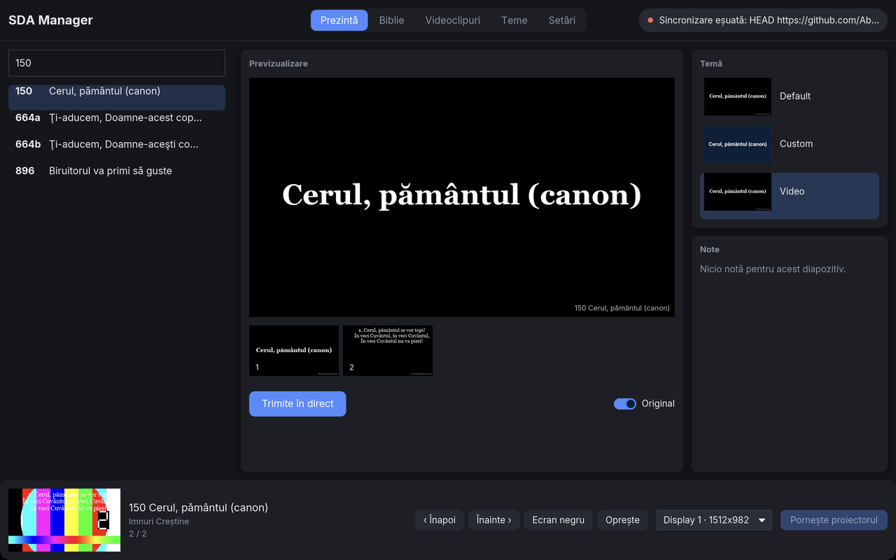
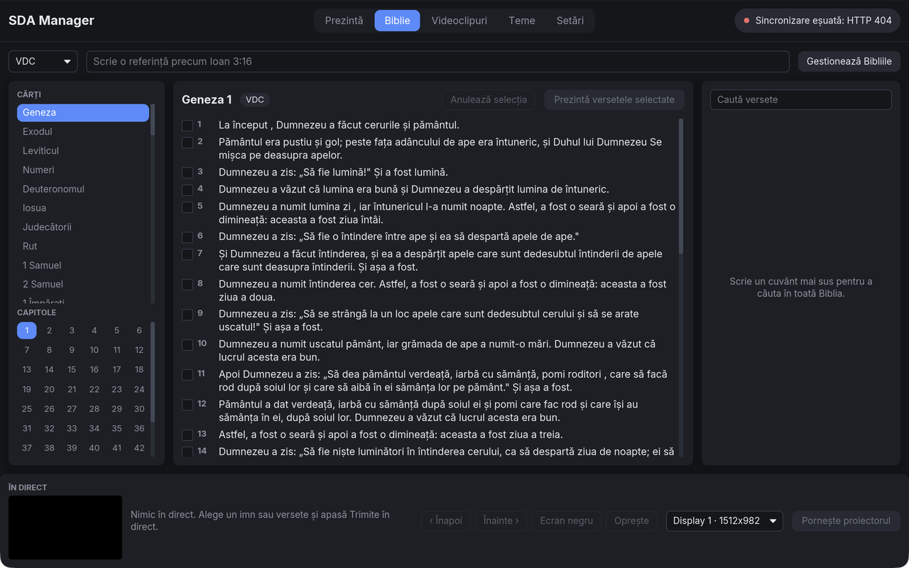
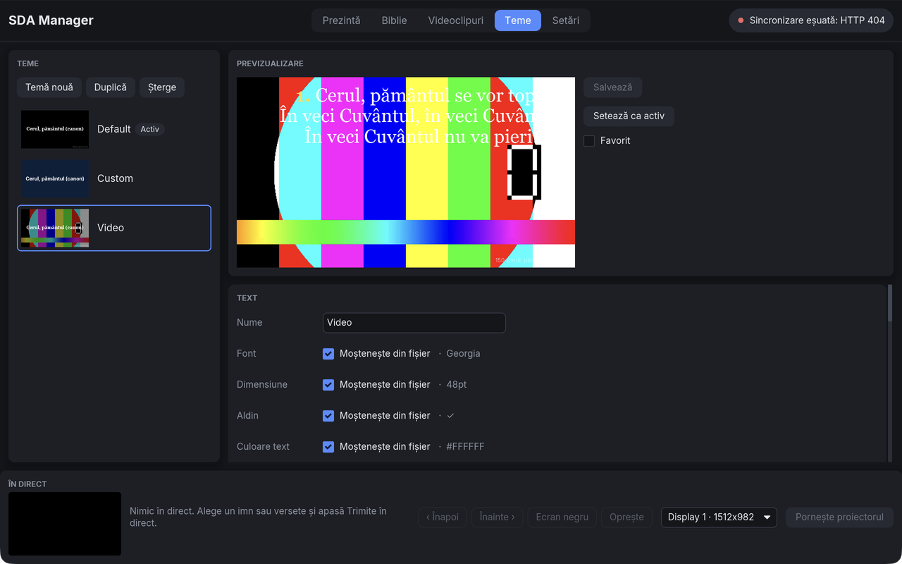
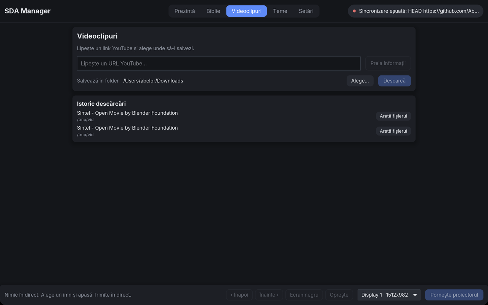
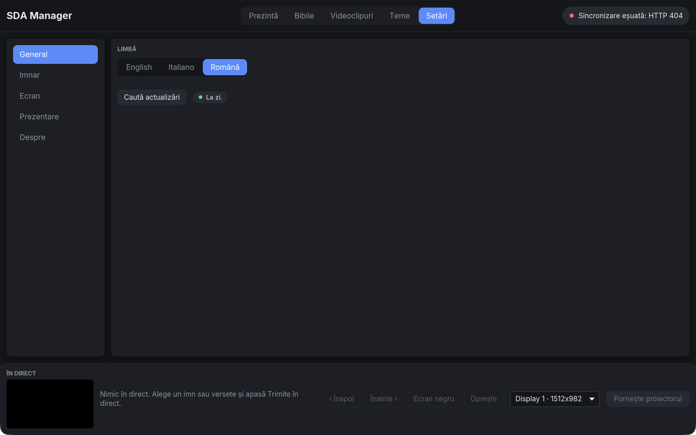

<div align="center">

# SDA Manager

**Find a hymn or a verse and put it on the screen in seconds.**

A free, cross-platform desktop app for projecting hymns and Bible verses
during a service. Search a hymnal by number, title, or a half-remembered line
of the lyrics, type a Bible reference, then project it full screen on the
sanctuary display with your own styling. No PowerPoint and no fiddling in the
middle of a service.

Runs on **macOS**, **Windows**, and **Linux**. Available in **English**,
**Italian**, and **Romanian**.

[Download](https://github.com/AbelHristodor/sda_manager/releases) ·
[Install](#install) · [Features](#features) · [For developers](#for-developers)

</div>

---

## Why

Getting a hymn on the projector often means hunting through folders of
PowerPoint files while the congregation waits. SDA Manager replaces that with
one search box. Type `plecati`, press Enter, and *Plecaţi-vă* is on the wall.

It ships with a full hymnal that stays current on its own. You can add your own
folders of slides too.

## Features

- **Instant fuzzy search.** Search by number, title, filename, or any lyric
  line. Search ignores accents, so `plecati` finds *Plecaţi-vă*.
- **Bible verses.** Type a reference like `John 3:16` or `Ioan 3,16-18`, or
  search the text. Present one verse or a range, themed like a hymn. Download
  Bible versions in many languages and switch between them.
- **Built-in projector.** The app draws the slides itself on a second display
  with a GPU renderer. It needs no PowerPoint and works the same on every OS.
- **Preview and Live.** Check every slide in the Present tab, then go live.
  The Live strip stays visible on every tab and shows what the projector shows.
- **Custom themes.** Four bundled fonts and any system font. Solid, gradient,
  particle, image, and looping video backgrounds. Pick auto or fixed text
  size, bold, alignment, line spacing, margin, shadow, outline, and footer.
  Each property can follow the original slide or override it.
- **Slide transitions.** Fade, slide, scale, and blur with easing.
- **As-is mode.** When LibreOffice or PowerPoint is installed, any hymn can be
  shown exactly as the original file looks. The choice is saved per hymn.
- **History.** The last 50 hymns you opened, newest first.
- **Your own libraries.** Add any folder of `.pptx` files next to the built-in
  hymnal.
- **Video downloader.** Paste a YouTube link, pick a quality, and save the
  video to a folder.
- **Multilingual UI.** English, Italian, and Romanian.
- **Keyboard first.** Every live action has a key. See the table below.
- **Always up to date.** The hymnal and the app update from the latest release.

## Screenshots











## Install

Prebuilt apps are on the
[Releases](https://github.com/AbelHristodor/sda_manager/releases) page for
macOS on Apple Silicon, Windows x86_64, and Linux x86_64.

**macOS and Linux.** Paste into a terminal:

```sh
curl -fsSL https://raw.githubusercontent.com/AbelHristodor/sda_manager/main/install.sh | sh
```

The macOS app is unsigned. The first time, right click it and choose **Open**.
It installs `sda-manager` to `~/.local/bin`. Set `BIN_DIR` to change that.

**Windows.** Paste into PowerShell:

```powershell
irm https://raw.githubusercontent.com/AbelHristodor/sda_manager/main/install.ps1 | iex
```

It installs to `%LOCALAPPDATA%\Programs\sda-manager`, adds a Desktop shortcut,
and puts `sda-manager` on your `PATH`.

## Using it

### Hymns

1. **Search.** Open the Present tab and type in the search box. Up and Down
   move the selection.
2. **Preview.** The selected hymn shows its slides as thumbnails and a large
   preview. Click a thumbnail to preview it.
3. **Go Live.** Press Enter or click **Go Live**. The slide moves to the Live
   strip and the projector.
4. **Projector.** Press Cmd/Ctrl+O or use the Live strip to turn the projector
   on and pick a display.
5. **Themes and Settings.** The Themes tab edits and picks themes. Settings
   adds folders, changes language, picks a Bible version, and syncs the
   hymnal.

### Bible verses

1. **Pick a version.** The first time, open the Bible tab and download a
   version. Known public domain versions are marked.
2. **Find a passage.** Type a reference like `Ps 23` or `Giovanni 3:16-18` in
   your UI language, or browse by book and chapter, or search the text.
3. **Select verses.** Tick a verse to add it. Use **Select to here** on a later
   verse to add the whole range.
4. **Present.** Click **Present selected verses**. The verses go live with the active theme,
   with the reference above or below them as the theme chooses.

### Keyboard

Shortcuts do nothing while a text field has focus.

| Key | Action |
|---|---|
| Cmd/Ctrl+K | focus search |
| Cmd/Ctrl+O | toggle projector |
| Cmd/Ctrl+1..5 | switch tab |
| Up / Down | move selection |
| Enter | go live with the previewed slide |
| Left / Right, Space | live prev / next |
| B | blank toggle |
| 1..9 | live jump to slide N |
| Esc | stop the projector |

---

## For developers

SDA Manager is written in Rust with Iced 0.14 and wgpu. It reads the text and
styling out of `.pptx` files and draws the slides itself.

### Workspace layout

```
crates/
  sda-core/    # logic, no UI, no GPU: pptx, index, search, themes, resolve,
               # Bible, history, sync, downloader. Tested with fixtures.
  sda-render/  # wgpu scene renderer, no Iced. Tested headless with golden PNGs.
  sda-app/     # Iced app, binary `sda-manager`. Tested with iced_test.
```

### Building from source

```sh
cargo build --release -p sda-app      # binary at target/release/sda-manager
cargo run --release -p sda-app        # build and run
```

Rust 1.88 or newer. Use `--release` for daily use. Set
`RUST_LOG=sda_app=debug,sda_core=debug,sda_render=debug` to log indexing,
sync, search, and rendering.

On Linux install `libxkbcommon-dev libwayland-dev libxcb-render0-dev
libxcb-shape0-dev libxcb-xfixes0-dev libgtk-3-dev libasound2-dev` first.

### How libraries work

A library is a folder of `.pptx` files. Each folder is crawled recursively.
Lock files and other file types are skipped. The default library is the
`hymns.zip` asset of the latest release. The app downloads it on first run and
again only when its ETag changes. A cached index means later launches only
parse files that changed.

### Configuration

Config is a TOML file in the OS config directory:

- **macOS:** `~/Library/Application Support/org.hymnal.HymnFinder/config.toml`
- **Windows:** `%APPDATA%\hymnal\HymnFinder\config\config.toml`
- **Linux:** `~/.config/HymnFinder/config.toml`

The default library lives in `…/org.hymnal.HymnFinder/hymns` with the last
ETag in `hymns.etag`. Themes live in `…/themes/*.json`. Bibles live in
`…/bibles/<code>.json`. History, per hymn overrides, download records, and
window geometry are small JSON files next to them. The index cache is
`…/org.hymnal.HymnFinder/index.bin` in the OS cache dir.

Point `hymns_url` at your own `hymns.zip`, pick a Bible version, or add
libraries directly:

```toml
hymns_url = "https://example.com/hymns.zip"
bible_version = "en_kjv"

[[libraries]]
name = "Imnuri Creștine"
path = "/path/to/hymns"
enabled = true
managed_by_git = false
```

### Bible data

Bible text comes from the
[thiagobodruk/bible](https://github.com/thiagobodruk/bible) repository. Every
download points at one pinned commit so the files never change under the app.
The copyright of each version belongs to its owner. The app marks the versions
it knows to be public domain, such as `en_kjv`. Versions it knows to be
restricted, such as `en_niv`, are marked too. An unmarked version is not known
to be free. Check the license before you use a version in public.

### Tests

```sh
cargo test --workspace
cargo test -p sda-core                # fixtures in crates/sda-core/tests/fixtures
cargo test -p sda-render              # golden PNGs, skipped without a GPU
UPDATE_GOLDENS=1 cargo test -p sda-render   # rewrite the goldens
cargo test -p sda-app                 # iced_test simulator
```

Core tests cover text extraction, accent folding, ranking, cache invalidation,
zip sync against a local HTTP stub, themes, resolve, presentation state, text
fit, history, converter detection, and the Bible loader, reference parser, and
search. Render tests compare each scene to a PNG in
`crates/sda-render/tests/golden`. App tests drive the views with the
`iced_test` simulator.

### Fonts

Inter, Noto Serif, and Lora use the SIL Open Font License. Roboto Slab uses the
Apache 2.0 license.

### Releases

Run the **Release** workflow from the Actions tab with a tag like `v3.0.0`. It
tests on all three platforms, then publishes one archive per platform plus
`hymns.zip` built from `assets/920`. Running apps pick up the new `hymns.zip`
on their next launch.
